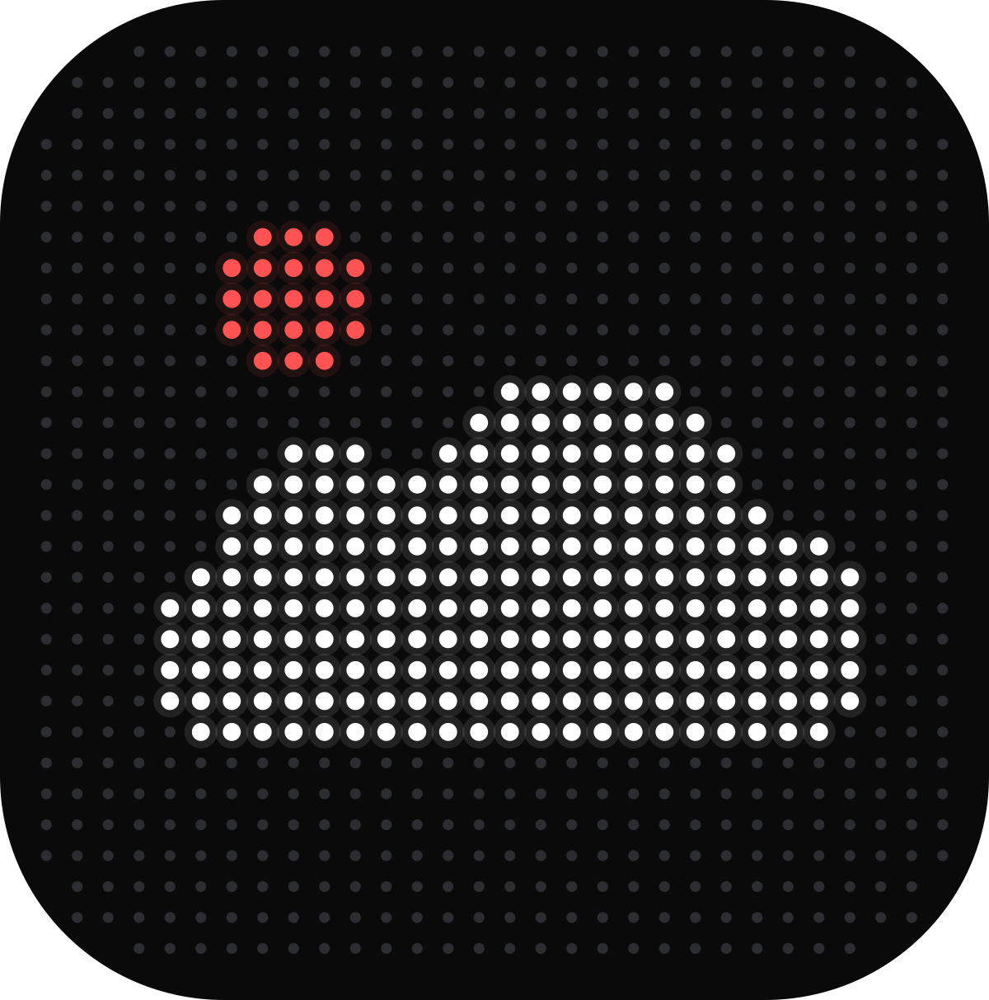
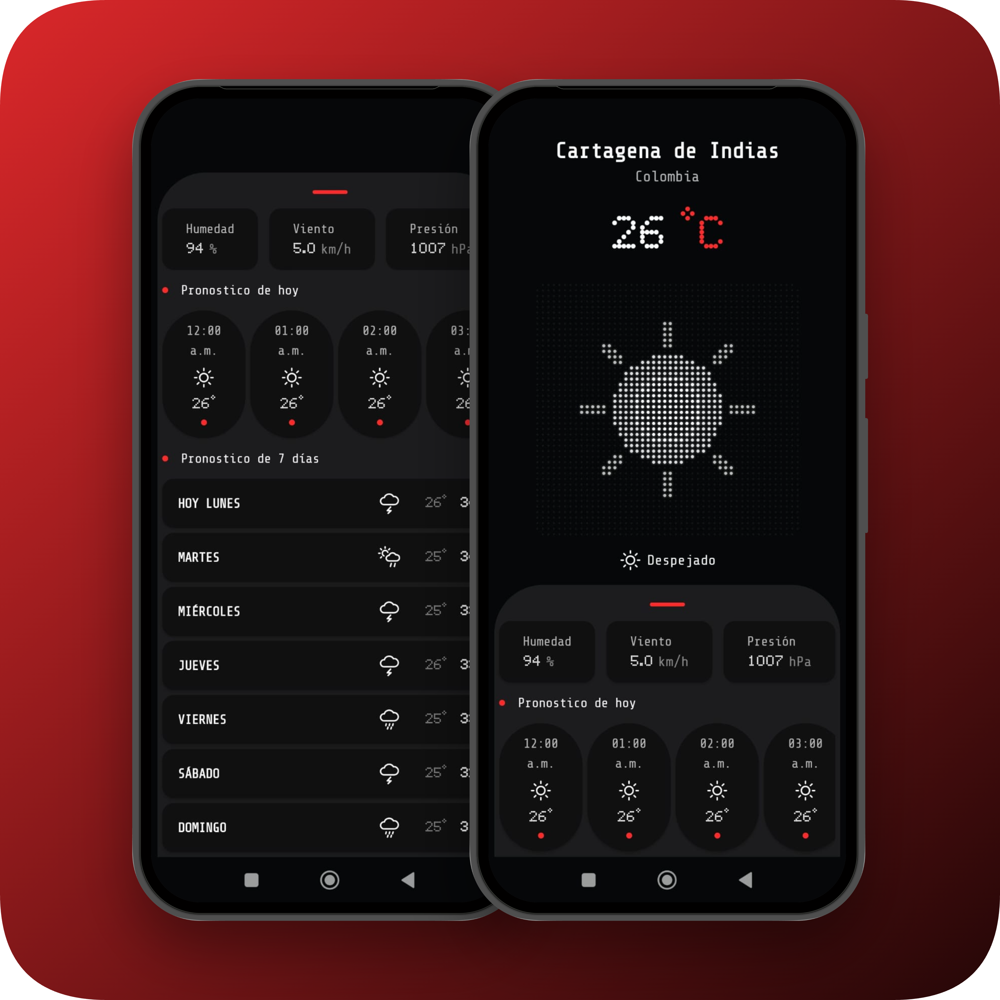
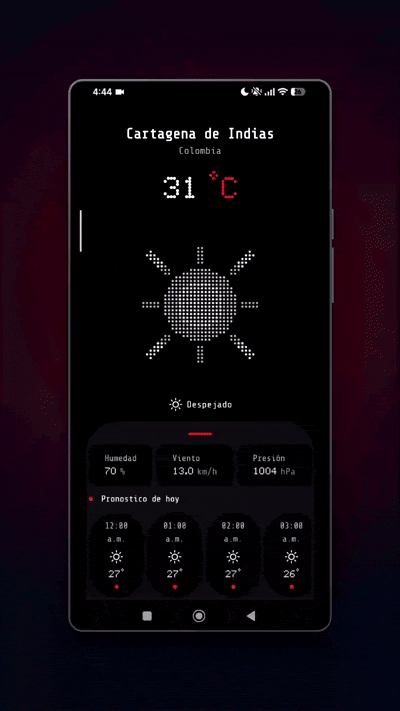
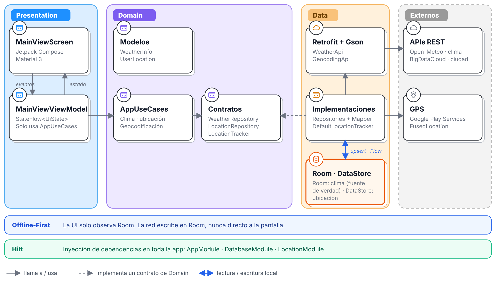

<div align="center">

<div align="center"> <h1 align="center">  WeatDot </h1>
**Aplicación de clima para Android con Clean Architecture, Jetpack Compose y Room como fuente de datos de la UI.**


[Capturas](#capturas) · [Arquitectura](#arquitectura) · [Ejecutar](#como-ejecutarlo) · [Pruebas](#pruebas) · [Licencia](#licencia)

</div>

---

## Capturas

<div align="center">
  
  <br><br>
  
</div>

---

## Funcionalidades

- Clima actual: temperatura, humedad, viento y presión.
- Pronóstico por hora del día y pronóstico diario.
- Ubicación por GPS con geocodificación inversa (ciudad y país en el idioma del dispositivo).
- Persistencia de la última ubicación con DataStore, con respaldo si no hay GPS ni permisos (Londres por defecto).
- Caché local con Room: la app sigue mostrando datos sin conexión.
- Actualización con pull-to-refresh.
- Animaciones de clima con Lottie.
- Tema claro y oscuro.
- Interfaz en español e inglés.
- No requiere API keys ni configuración previa.

---

## Arquitectura

WeatDot sigue **Clean Architecture** en tres capas, con **MVVM y flujo unidireccional de datos (UDF)** en la presentación y **Hilt** para la inyección de dependencias.

<div align="center">
  
</div>

El detalle completo (casos de uso, repositorios y módulos de Hilt) está en el [diagrama detallado](docs/images/weatdot-architecture-full.png) y en la [documentación de arquitectura](docs/architecture.md).

| Capa | Qué contiene | Responsabilidad |
| :-- | :-- | :-- |
| **Presentation** | `MainViewScreen`, `MainViewViewModel`, `MainViewUiState` | Dibuja la UI, pide permisos y expone un `StateFlow` inmutable. No conoce Retrofit, Room ni DataStore. |
| **Domain** | `AppUseCases`, `WeatherRepository`, `LocationRepository`, `LocationTracker`, modelos | Reglas de la app y **contratos**. No sabe cómo se obtienen los datos. |
| **Data** | `WeatherRepositoryImpl`, `LocationRepositoryImpl`, Retrofit, Room, DataStore, `DefaultLocationTracker`, mappers | Implementa los contratos y conecta con APIs, base de datos y GPS. |

### Flujo de datos

1. El usuario abre la app o hace pull-to-refresh, y `MainViewScreen` envía el evento al ViewModel.
2. El ViewModel obtiene la ubicación (GPS o la última guardada) a través de `AppUseCases`.
3. El repositorio consulta Open-Meteo con Retrofit y mapea la respuesta (DTO) a una entidad.
4. La entidad se guarda en Room con un upsert.
5. Room emite un `Flow`, el mapper lo convierte a `WeatherInfo` y el ViewModel actualiza el `StateFlow`.
6. Compose se recompone con el nuevo estado.

### Decisiones de diseño

| Decisión | Por qué |
| :-- | :-- |
| **Room como fuente de datos de la UI** | La pantalla solo observa la base local. La red únicamente escribe en Room, así la UI no depende de la conexión y los datos siguen disponibles sin internet. |
| **Interfaces en Domain, implementaciones en Data** | Los casos de uso y el ViewModel no dependen de Retrofit, Room ni DataStore. Se pueden cambiar o simular en tests. |
| **`AppUseCases` como fachada** | El ViewModel recibe una sola fachada en vez de inyectar múltiples casos de uso por separado, y los tests son más simples. |
| **MVVM con UDF** | Estado inmutable con `copy`, un único `StateFlow` y eventos hacia abajo. Para una sola pantalla, evitar intents y reducers mantiene el código simple. |
| **Mappers explícitos (DTO, Entity, Domain)** | Cada capa tiene su propio modelo, así un cambio en la API no se propaga hasta la UI. |
| **Pantalla stateful y contenido stateless** | `MainViewScreen` maneja estado y permisos; `MainViewContent` solo dibuja, lo que facilita previews y pruebas. |

---

## Stack tecnológico

| Área | Tecnologías |
| :-- | :-- |
| **Lenguaje** | Kotlin, Coroutines, Flow |
| **UI** | Jetpack Compose, Material 3, Lottie |
| **Arquitectura** | Clean Architecture, MVVM, UDF |
| **Inyección de dependencias** | Hilt y KSP |
| **Red** | Retrofit, Gson |
| **Persistencia** | Room, DataStore Preferences |
| **Ubicación** | Google Play Services (FusedLocationProviderClient) |
| **Pruebas** | JUnit, MockK, Turbine, Truth, kotlinx-coroutines-test |
| **Build** | Gradle (Kotlin DSL), Version Catalog |

---

## Estructura del proyecto

```text
app/src/main/java/com/tomildev/weatdot/
├── WeatDotApplication.kt        # @HiltAndroidApp
├── MainActivity.kt              # Punto de entrada
├── core/
│   ├── domain/                  # Reglas de negocio
│   │   ├── model/               # WeatherInfo, UserLocation, WeatherType…
│   │   ├── repository/          # WeatherRepository, LocationRepository (interfaces)
│   │   ├── location/            # LocationTracker (interfaz)
│   │   └── use_case/            # AppUseCases y casos de uso individuales
│   ├── data/
│   │   ├── remote/              # WeatherApi, GeocodingApi (Retrofit) + DTOs
│   │   ├── local/               # Room y DataStore
│   │   ├── repository/          # WeatherRepositoryImpl, LocationRepositoryImpl
│   │   ├── location/            # DefaultLocationTracker
│   │   └── mapper/              # WeatherMapper
│   ├── di/                      # AppModule, DatabaseModule, LocationModule
│   └── presentation/components/ # Componentes de UI reutilizables
├── features/
│   └── mainview/presentation/   # Pantalla, ViewModel, UiState y componentes
└── ui/theme/                    # Colores, tipografía, dimensiones e íconos
```

---

<h2 id="como-ejecutarlo">Cómo ejecutarlo</h2>

**Requisitos:** Android Studio reciente y un dispositivo o emulador con Android 8.0 (API 26) o superior.

```bash
git clone https://github.com/Milton-Peluffo/WeatDot.git
```

1. Abre la carpeta en Android Studio y espera a que Gradle sincronice.
2. Ejecuta la configuración `app` en un emulador o dispositivo.
3. Acepta el permiso de ubicación para ver el clima de tu zona. Si lo rechazas, la app usa la última ubicación guardada o Londres (por defecto).

Open-Meteo y BigDataCloud se consumen sin autenticación, así que no hace falta ninguna clave.

Por terminal en Windows, usa `gradlew.bat`:

```powershell
.\gradlew.bat assembleDebug    # compilar
.\gradlew.bat installDebug     # instalar en un dispositivo conectado
```

---

## Pruebas

```bash
./gradlew test
```

| Prueba | Qué verifica |
| :-- | :-- |
| `WeatherMapperTest` | Conversión DTO, Entity y modelo de dominio, y filtro de las horas del día. |
| `MainViewViewModelTest` | Estado inicial, de carga y exitoso, usando MockK y Turbine para observar las emisiones del `StateFlow`. |

---

## Licencia

WeatDot es **código disponible: source-available**, no software de código abierto. El código es público para que se pueda leer, compilar y aprender de él, pero su distribución y su uso comercial están reservados al autor.

| Permitido | No permitido sin autorización |
| :-- | :-- |
| Clonar y hacer fork del repositorio | Publicar la app o sus derivados en Google Play u otra tienda |
| Compilar y ejecutar la app en tus dispositivos | Distribuir APK o AAB por cualquier canal |
| Modificarla en tu copia o fork, con fines personales, educativos o de investigación | Vender o monetizar la app o sus derivados (anuncios, compras, suscripciones) |
| Revisar el código con fines de evaluación profesional | Usarla en un producto o servicio comercial, o presentarla como obra propia |

El texto completo está en [LICENSE](LICENSE). Las librerías y servicios de terceros se rigen por sus propias licencias.

---

## Documentación

- [Arquitectura detallada](docs/architecture.md)
- [Diagrama completo](docs/images/weatdot-architecture-full.png)

## Créditos y datos

- Datos meteorológicos de [Open-Meteo](https://open-meteo.com/).
- Geocodificación inversa de [BigDataCloud](https://www.bigdatacloud.com/).
- Fuente punteada de [Online web fonts](http://www.onlinewebfonts.com).
